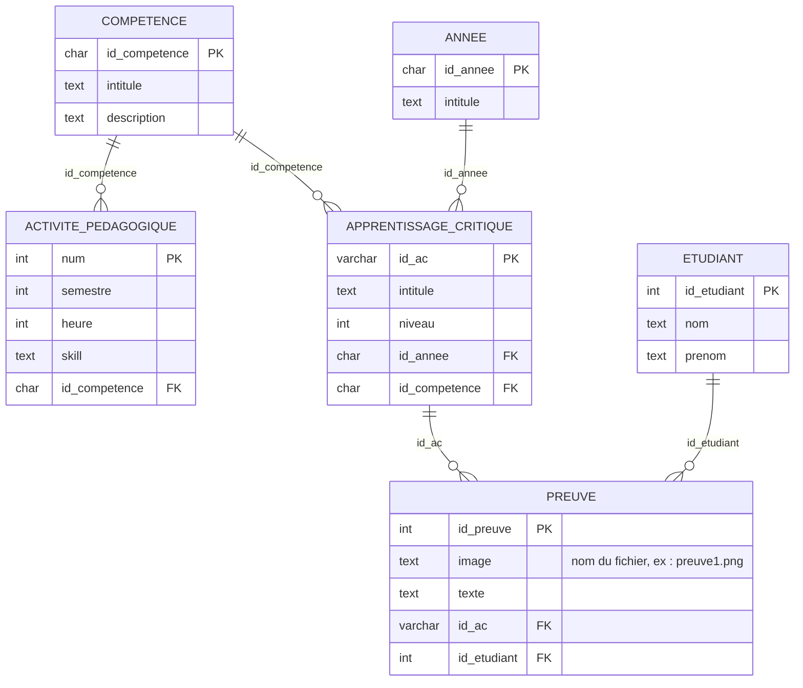

# Exercice 1 – Schéma relationnel

## Explications
- Dans le schéma de départ, il y avait deux groupes séparés :
  COMPETENCE–ACTIVITE_PEDAGOGIQUE et ANNEE–APPRENTISSAGE_CRITIQUE.
- J'ai ajouté `id_competence` dans APPRENTISSAGE_CRITIQUE, car chaque AC
  appartient à une compétence. Maintenant toutes les tables sont reliées.
- J'ai ajouté ETUDIANT et PREUVE : une preuve (image et/ou texte) montre
  qu'un étudiant a acquis un apprentissage critique.
